# DevOps Midterm - Evidence Report

| | |
|---|---|
| Student | **Batyr Gazizbek** |
| Group / ID | IT2-2301 / 38091 |
| Repository | https://github.com/gazizbekbr-tech/gazizbek-batyr-student-api |
| Docker image | `gazizbek-batyr-student-api:v1.0-gazizbek-batyr`, `:v1.1-gazizbek-batyr` |
| Compose project | `gazizbek-batyr-student-api` |
| Jenkins job | `Gazizbek_Batyr_Student_API` |
| API base URL | `http://localhost:8091/api/gazizbek-batyr/students` |
| Date | 29 October 2026 |

Environment: macOS (Apple Silicon) host, Docker Engine 29 in a Colima Linux VM (Ubuntu 24.04),
Linux part executed in an Ubuntu 24.04 container as user `batyr`, Jenkins 2.580.2 LTS (JDK 21) in Docker.

All terminal transcripts are in [`docs/evidence/`](evidence/), screenshots in [`docs/screenshots/`](screenshots/),
the scripts that produced the transcripts in [`scripts/demo/`](../scripts/demo/).

---

## Part 1 - Linux administration

### 1.1 Project structure
Created with `mkdir -p` and `touch`, verified with `tree` and a loop that prints `OK`/`MISSING` for every
required path. Transcript: [part1_task1_structure.txt](evidence/part1_task1_structure.txt)

```
.
|-- Dockerfile
|-- Jenkinsfile
|-- README.md
|-- backups
|-- build.gradle
|-- docker-compose.yml
|-- logs
|   `-- Gazizbek_Batyr_system_report.log
|-- scripts
|   `-- Gazizbek_Batyr_system_report.sh
`-- src
5 directories, 7 files
```

### 1.2 System monitoring script
[`scripts/Gazizbek_Batyr_system_report.sh`](../scripts/Gazizbek_Batyr_system_report.sh) prints the full name,
date/time, username, OS and kernel, CPU (`lscpu`), memory (`free -h`), disk usage (`df -h`) and available
space on `/`, and appends everything to `logs/Gazizbek_Batyr_system_report.log` with `tee -a`.
Transcript: [part1_task2_3.txt](evidence/part1_task2_3.txt), log: [Gazizbek_Batyr_system_report.log](evidence/Gazizbek_Batyr_system_report.log)

```
Student full name : Batyr Gazizbek
Username          : batyr
Operating system  : Ubuntu 24.04.5 LTS
Kernel            : Linux 6.8.0-117-generic (aarch64)
```

### 1.3 Permissions and backup
```
$ chmod +x scripts/Gazizbek_Batyr_system_report.sh      -> -rwxr-xr-x
$ chmod 744 scripts/Gazizbek_Batyr_system_report.sh     -> -rwxr--r--  (owner rwx, group r, others r)
$ cp README.md backups/README_Gazizbek_Batyr_backup.md
$ diff README.md backups/README_Gazizbek_Batyr_backup.md && echo 'Backup is identical to README.md'
Backup is identical to README.md
```
`sha256sum` of both files is identical. Transcript: [part1_task2_3.txt](evidence/part1_task2_3.txt)

### 1.4 Process and log analysis
`ps aux` / `pgrep -a java` found the Spring Boot process (`java -jar /app/app.jar`, PID 11224);
`tail -n 5` shows the end of the log; `grep -n 'Gazizbek'` found 6 matches, saved to
[Gazizbek_Batyr_log_analysis.txt](evidence/Gazizbek_Batyr_log_analysis.txt).
Transcript: [part1_task4_process_log.txt](evidence/part1_task4_process_log.txt)

**`>` vs `>>`:** `>` redirects output to a file and overwrites it (truncates first, creates if missing);
`>>` appends to the end and keeps the old content. Demonstrated in the transcript: two `>` writes leave
only the second line, a following `>>` adds a third line.

---

## Part 2 - Git and GitHub

### 2.1 Repository initialization
`git init -b main`, `git config user.name "Batyr Gazizbek"`, `.gitignore` (build output, IDE files,
`logs/*.log`, `.env`, keys, Jenkins data), first commit **`Initial commit: Gazizbek Batyr Student API`**.
`git check-ignore` proves the log file is ignored. Transcript: [part2_task1_init.txt](evidence/part2_task1_init.txt)

### 2.2 Feature branch `feature/gazizbek-batyr-crud`
Implemented the **Update** operation (`PUT /api/gazizbek-batyr/students/{id}` with validation, 404 and
409 handling) in three commits, then merged with `--no-ff`:

```
a2b8d8e Implement student update (PUT) endpoint - Gazizbek Batyr
709ed4b Add tests for student update and missing-student 404 - Gazizbek Batyr
b33a645 Document student update operation in README - Gazizbek Batyr
aaba98a Merge feature/gazizbek-batyr-crud: student update operation
```
Transcript: [part2_task2_feature.txt](evidence/part2_task2_feature.txt)

### 2.3 Conflict resolution
`feature/gazizbek-batyr-documentation` and `main` both changed the `Project status:` line of README.md.

```
$ git merge feature/gazizbek-batyr-documentation
CONFLICT (content): Merge conflict in README.md
<<<<<<< HEAD
Project status: full CRUD (create, read, update, delete) is implemented.
=======
Project status: API documented with curl examples by Batyr Gazizbek.
>>>>>>> feature/gazizbek-batyr-documentation
```
Resolved by hand (markers removed, both meanings combined), `git add`, commit
`290b6cc Merge documentation branch, resolve README status conflict - Gazizbek Batyr`.
Transcript: [part2_task3_conflict.txt](evidence/part2_task3_conflict.txt)

### 2.4 Remote repository and tag
Public repository created with `gh repo create`, `main`, both feature branches and the test branch pushed,
annotated tag **`v1.0-gazizbek-batyr`** pushed.
Transcripts: [part2_task4_remote.txt](evidence/part2_task4_remote.txt), [part2_task4_tag.txt](evidence/part2_task4_tag.txt),
[part2_task4_summary.txt](evidence/part2_task4_summary.txt) (remote URL, full graph, branches, tags).

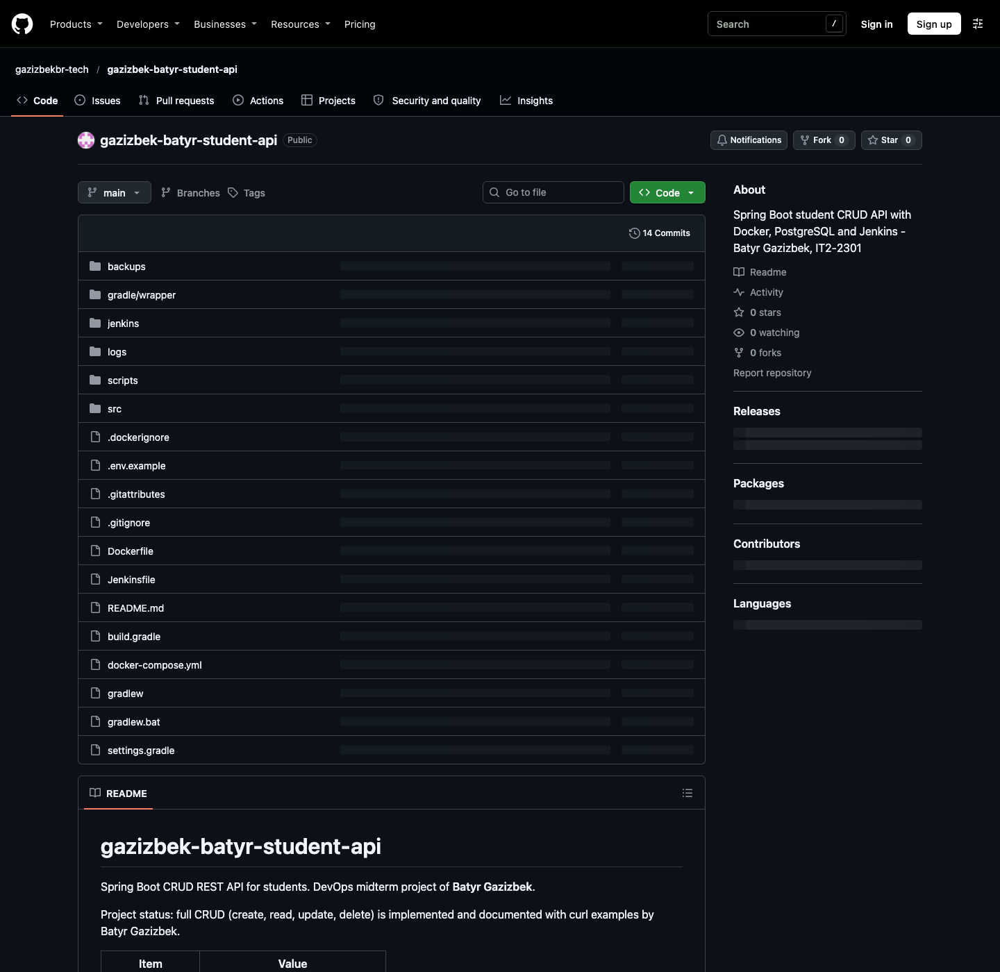
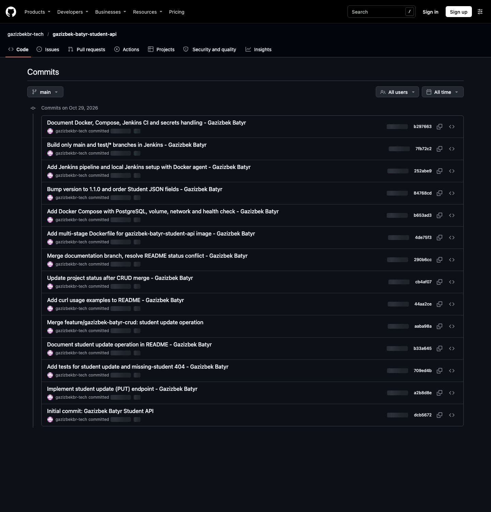
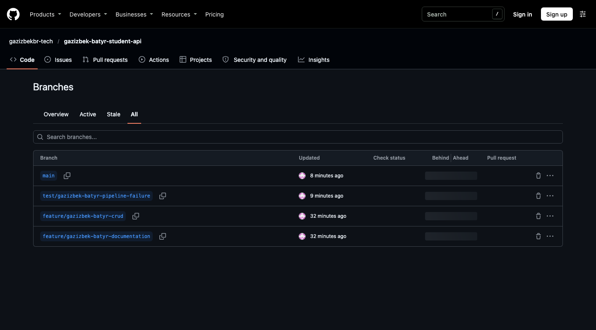
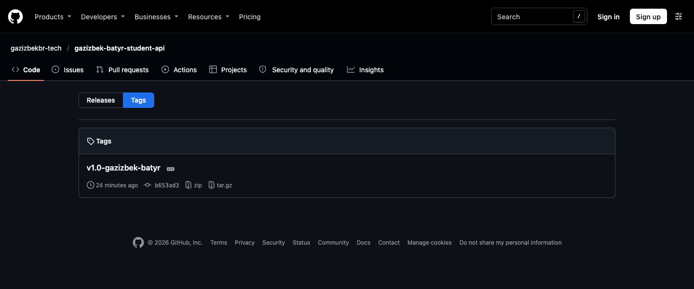

**Why `.env` files, passwords and DB credentials must not be committed:** Git keeps every version forever,
so a committed secret stays in the history and in every clone even after it is deleted; anyone with read
access (everyone, for a public repo) can use it, and bots scan GitHub for keys within minutes. Secrets also
differ per environment. Instead: `.gitignore` the `.env`, commit a `.env.example` with placeholders, pass
values as environment variables, and keep CI secrets in Jenkins Credentials. A leaked secret must be rotated.

---

## Part 3 - Docker and Docker Compose

### 3.1 Multi-stage Dockerfile
Build stage `eclipse-temurin:21-jdk` runs the Gradle wrapper (`bootJar`); runtime stage
`eclipse-temurin:21-jre` gets only the jar, runs as non-root user `spring`, `EXPOSE 8091`.
Image `gazizbek-batyr-student-api:v1.0-gazizbek-batyr`, 163 MB content size, linux/arm64,
labels with author and version. Transcript: [part3_task1_dockerfile.txt](evidence/part3_task1_dockerfile.txt)

### 3.2 Compose + PostgreSQL
Services `gazizbek-batyr-app` and `gazizbek-batyr-db` (postgres:17-alpine, `pg_isready` health check),
env variables from `.env`, named volume `gazizbek-batyr-pgdata`, bridge network `gazizbek-batyr-net`,
app waits for `service_healthy`. The app uses `jdbc:postgresql://gazizbek-batyr-db:5432/gazizbek_batyr_db`
(service name, resolved by Docker DNS to 172.18.0.2). Transcript: [part3_task2_compose.txt](evidence/part3_task2_compose.txt)

```
NAME                      IMAGE                                            STATUS                   PORTS
gazizbek-batyr-app        gazizbek-batyr-student-api:v1.0-gazizbek-batyr   Up                       0.0.0.0:8091->8091/tcp
gazizbek-batyr-postgres   postgres:17-alpine                               Up 5 seconds (healthy)   5432/tcp
```

### 3.3 Container management
`docker ps`, `docker logs`, `docker inspect` (image, ports, networks, env with the password filtered out,
volume mount), `docker exec` (whoami, java -version, ls), `docker compose stop/start/restart`.
Persistence: a record was inserted, `docker compose down` removed containers and network, the volume stayed,
after `docker compose up -d` the record is still there and the seeder logs `Database already contains 4 students, seed skipped`.
Transcript: [part3_task3_manage.txt](evidence/part3_task3_manage.txt)

Version change: `build.gradle` 1.0.0 -> 1.1.0, image rebuilt as `v1.1-gazizbek-batyr`, `/` now reports
`"version":"1.1.0"`. Transcript: [part3_task3_version.txt](evidence/part3_task3_version.txt)

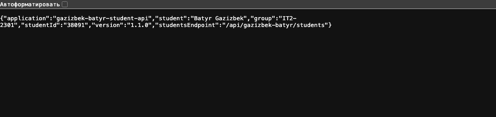

### 3.4 API testing with curl
| Request | Result |
|---|---|
| `POST /api/gazizbek-batyr/students` (Batyr Gazizbek) | `201 Created`, `Location: .../students/6` |
| `GET /api/gazizbek-batyr/students` | `200`, list with my test data |
| `GET /api/gazizbek-batyr/students/{id}` | `200` |
| `PUT /api/gazizbek-batyr/students/{id}` (course 3 -> 4, new email) | `200` |
| `DELETE /api/gazizbek-batyr/students/{id}` | `204 No Content` |
| `GET` / `PUT` / `DELETE` on a nonexistent id | `404` with JSON `"Student with id ... not found"` |
| `POST` with invalid data (extra) | `400` with field errors |

Transcript: [part3_task4_api_tests.txt](evidence/part3_task4_api_tests.txt)

---

## Part 4 - Jenkins CI/CD

### 4.1 Jenkins setup
Jenkins runs from [`jenkins/`](../jenkins/): the controller image installs plugins and is configured by
Configuration as Code ([`casc.yaml`](../jenkins/controller/casc.yaml)): admin user, JDK tool `jdk21`,
credential `gazizbek-batyr-verify-db-password` (secret text), multibranch job `Gazizbek_Batyr_Student_API`
pointing at the GitHub repository. Builds run on a separate inbound agent `gazizbek-batyr-docker-agent`
(label `docker`, JDK 21 + Docker CLI, uses the host Docker socket); the controller has 0 executors.
The repository is public, so checkout needs no credentials (for a private repo a GitHub token would be added
as a *Username with password* credential and set on the branch source).
Transcript: [part4_task1_setup.txt](evidence/part4_task1_setup.txt)

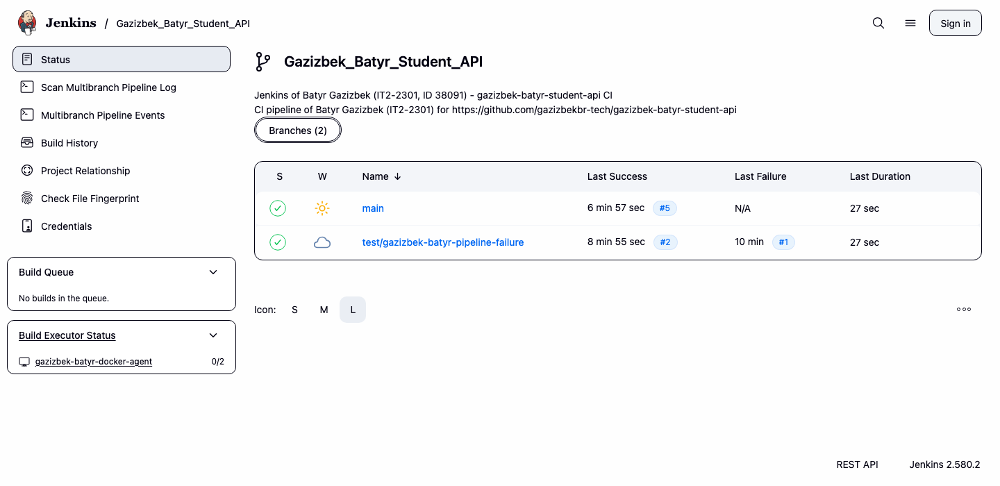
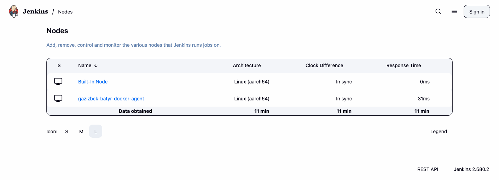
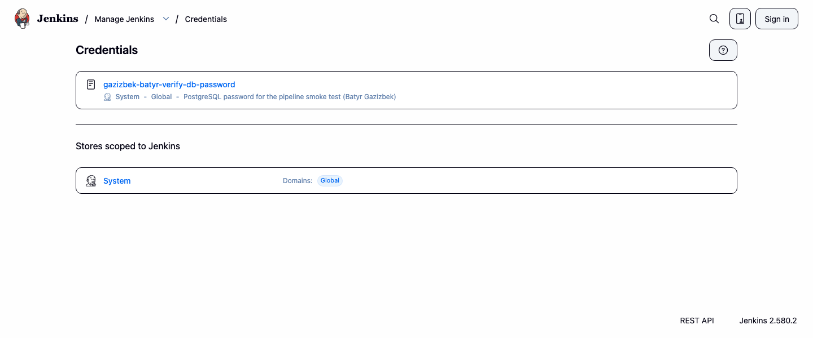

### 4.2 Jenkinsfile
Declarative pipeline [`Jenkinsfile`](../Jenkinsfile): **Checkout** (prints student, branch, commit, image tag)
-> **Build** (`./gradlew clean compileJava`) -> **Test** (`./gradlew test` + JUnit report) -> **Docker Build**
(`gazizbek-batyr-student-api:v1.1-gazizbek-batyr`) -> **Verify** (`docker image inspect`, then a smoke test:
starts PostgreSQL + the new image on a temporary network with the password from Jenkins Credentials and checks
that `/` answers `"student":"Batyr Gazizbek"`). Any failing `sh` step fails the stage and the following stages
are skipped. The console prints `Pipeline of Batyr Gazizbek (IT2-2301, ID 38091)`.
First successful run: [jenkins_main_build2_first_success_console.txt](evidence/jenkins_main_build2_first_success_console.txt)

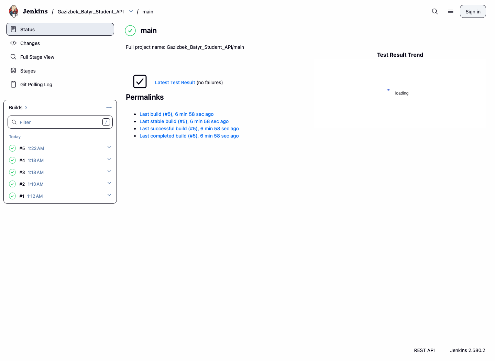

> main build #1 ran right after Jenkins started, before the Jenkinsfile was pushed (the file was still
> the empty one from Task 1.1), so it had no stages. Build #2 is the first real run.

### 4.3 Failure and fix on own test branch
Branch `test/gazizbek-batyr-pipeline-failure`, commit `53de29e Controlled error: wrong expected student name in info test`.

```
StudentControllerTests > infoShowsStudentName() FAILED
    java.lang.AssertionError: JSON path "$.student" expected:<Batyr Gazizbek - CONTROLLED ERROR> but was:<Batyr Gazizbek>
8 tests completed, 1 failed
Stage "Docker Build" skipped due to earlier failure(s)
Stage "Verify" skipped due to earlier failure(s)
Finished: FAILURE
```
**Explanation:** the test expected a wrong value, so `./gradlew test` returned exit code 1, the `Test` stage
failed and Jenkins skipped Docker Build and Verify - no image is built from code that fails its tests.
**Fix:** `3c43fb6 Fix info test expectation after controlled failure`, pushed; build #2 started automatically
(`Started by an SCM change`) and finished `SUCCESS`. `main` was never broken.

Consoles: [failed](evidence/jenkins_test-branch_build1_FAILED_console.txt), [fixed](evidence/jenkins_test-branch_build2_FIXED_console.txt),
transcript: [part4_task3_failure_fix.txt](evidence/part4_task3_failure_fix.txt)

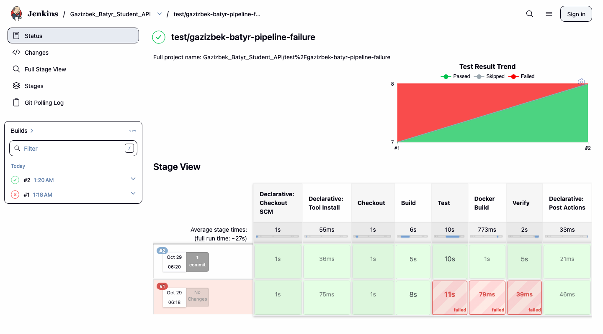
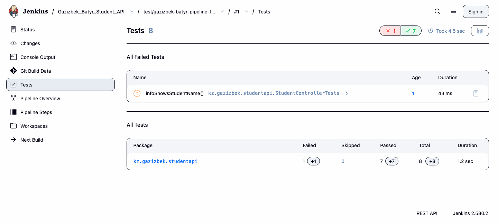

### 4.4 Automation
Trigger: `pollSCM('* * * * *')` in the Jenkinsfile (Jenkins checks GitHub every minute). A webhook needs
GitHub to reach Jenkins over the internet; this Jenkins is on localhost, so polling is the working option.
New commit `b297663 Document Docker, Compose, Jenkins CI and secrets handling` was pushed without starting
anything by hand; main build #5 started by itself:

```
Build #5 SUCCESS | cause: Started by an SCM change
#5  SUCCESS  2026-10-29 01:22:03 UTC
#4  SUCCESS  2026-10-29 01:18:45 UTC
#3  SUCCESS  2026-10-29 01:18:09 UTC
#2  SUCCESS  2026-10-29 01:13:03 UTC
#1  SUCCESS  2026-10-29 01:12:24 UTC
```
Transcript: [part4_task4_automation.txt](evidence/part4_task4_automation.txt), console: [jenkins_main_build5_auto_console.txt](evidence/jenkins_main_build5_auto_console.txt)

**CI vs Continuous Deployment:** Continuous Integration = every commit is merged often and automatically
built and tested, so integration problems are found immediately (this project: compile, tests, image,
smoke test). Continuous Delivery = every successful build is packaged and ready to release, a human approves
the release. Continuous Deployment = every build that passes the pipeline goes to production automatically,
no manual step. This project implements CI; deployment was not enabled.

---

## How to reproduce

```bash
git clone https://github.com/gazizbekbr-tech/gazizbek-batyr-student-api.git && cd gazizbek-batyr-student-api
./gradlew clean test bootJar
cp .env.example .env && docker compose up -d --build
curl -s http://localhost:8091/
./jenkins/start-jenkins.sh            # Jenkins on http://localhost:8080
```
